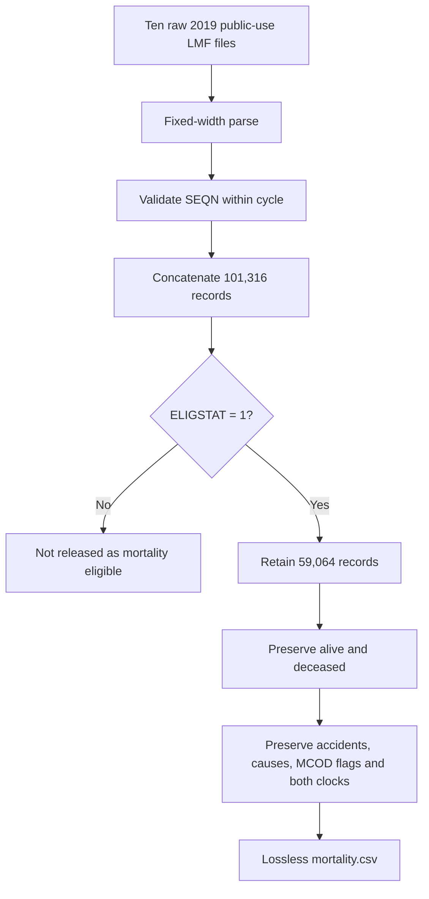

# Linked mortality cleaning and harmonisation audit

## Provenance conclusion

The mortality clean originated in R. The earliest
`NHANES_mort_to_csv.R` (original analysis; not included)
parsed the public-use fixed-width files but its final output discarded cause and
exam-clock fields, recoded missing cause, and removed accidental deaths.

A corrected
`NHANES_mort_to_csv_lossless.R` (original analysis; not included)
retained all mortality fields and accidental deaths. The release-candidate
`mortality_clean.py` (original analysis; not included)
was a Python translation of that corrected lossless R parser.

The current public pipeline now reruns an independently housed Python parser,
[`import_mortality.py`](../1_prepare_nhanes/1_cohort/06_import_mortality.py), directly from all ten
raw public-use Linked Mortality Files. It is no longer a historical dataframe
dependency.

## Raw format and cleaning logic

The source files are the 2019 Public-Use Linked Mortality Files, with follow-up
through 31 December 2019. The fixed-width fields are:

| Field | One-indexed columns | Meaning |
|---|---:|---|
| `SEQN` | 1–6 | NHANES participant identifier |
| `ELIGSTAT` | 15 | Mortality-linkage eligibility |
| `MORTSTAT` | 16 | Final mortality status |
| `UCOD_LEADING` | 17–19 | Public underlying-cause recode |
| Diabetes MCOD | 20 | Diabetes multiple-cause flag |
| Hypertension MCOD | 21 | Hypertension multiple-cause flag |
| `PERMTH_INT` | 43–45 | Follow-up months from interview |
| `PERMTH_EXM` | 46–48 | Follow-up months from examination |

Processing is deliberately lossless:

1. parse each cycle using the documented fixed-width layout;
2. assert nonmissing, unique cycle-level `SEQN`;
3. concatenate all ten cycles;
4. retain `ELIGSTAT == 1` records;
5. preserve survivors with missing cause of death;
6. preserve accidental deaths (`UCOD_LEADING == 4`);
7. preserve diabetes and hypertension MCOD flags;
8. preserve both follow-up clocks; and
9. attach a readable cause label without changing the numeric code.

The clean does not define a disease-death endpoint and does not discard records
with absent or zero follow-up. Those are downstream survival-analysis decisions.
The exam clock is preferred later because biomarker measurements occur at the
examination rather than the interview.

## Reconstruction result

| Result | Count |
|---|---:|
| Raw records across ten cycles | 101,316 |
| Mortality-eligible records | 59,064 |
| Alive at linkage close | 49,815 |
| Deceased | 9,249 |
| Duplicate eligible `SEQN` | 0 |

The reconstructed dataframe has zero participant or cell differences from the
certified lossless historical dataframe across all 59,064 rows and nine fields.
Its SHA-256 is
`F0EFA4619398095E785B389505E1ED79127D79AF2F28B113112D5E8E36217781`.

Byte hashes of the Python and legacy R CSVs differ because their serializers
write equivalent values differently; dataframe comparison is exact.

## Join to the biomarker master

Mortality was left-joined to the fixed 29,053-person analysis master. Linkage is
present for 29,023 participants; 30 remain explicitly unmatched. The linked
subset contains 3,028 deaths, including 106 accidental deaths. Both follow-up
clocks are populated and positive for the linked master cohort. No mortality
field entered participant eligibility, healthy-reference membership,
transformation selection or standardisation.

## Audit files

- [`mortality_sources.csv`](../1_prepare_nhanes/config/mortality_sources.csv)
- `1_prepare_nhanes/outputs/provenance/mortality_raw_manifest.csv` (made by the scripts)
- `1_prepare_nhanes/outputs/01_imported/mortality_import_summary.csv` (made by the scripts)
- `1_prepare_nhanes/outputs/01_imported/mortality.csv` (made by the scripts)
- `1_prepare_nhanes/outputs/01_imported/deaths_by_cause.csv` (made by the scripts)
- `compare_mortality.py` (original analysis; not included)
- `mortality_comparison.csv` (original analysis; not included)

Six automated tests protect row and death counts, participant uniqueness,
lossless schema, retention of accidental deaths, honest missing causes, both
follow-up clocks and exact historical agreement.
